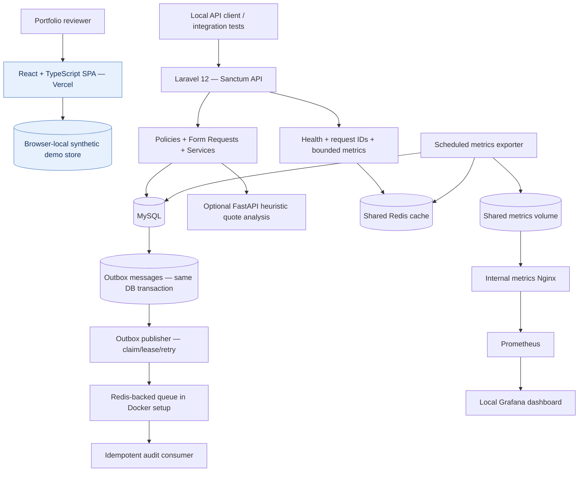

# ProcurePilot AI

**A production-style Laravel 12 backend case study in tenant isolation, concurrency-safe approvals, transactional outbox delivery, and local observability.**

[](https://github.com/Will-ammari/procurepilot-ai/actions/workflows/ci.yml)
[](https://github.com/Will-ammari/procurepilot-ai/actions/workflows/mysql-approval-concurrency.yml)
[](https://github.com/Will-ammari/procurepilot-ai/actions/workflows/frontend.yml)

**[Try the interactive demo](https://procurepilot-ai-nine.vercel.app/)** · **[Engineering case study](docs/engineering-case-study.md)** · **[Lighthouse report & methodology](docs/performance-lighthouse.md)** · **[API specification](docs/openapi.yaml)**

> **Deployment boundary:** the public Vercel site is a **React/TypeScript simulated demo** with synthetic browser-local data. Laravel, MySQL, Redis, the queue worker, and FastAPI are implemented in this repository and covered by separate tests, **but are not hosted behind the public demo**. The word “AI” in the name does not imply that the public demo calls a live AI model.

## Backend engineering evidence (November 22, 2026)

| Signal | Evidence | Scope |
| --- | --- | --- |
| Automated backend tests | **146 passed, 2 skipped, 559 assertions** in local PHPUnit | Two opt-in MySQL concurrency tests are excluded from the default local suite |
| Static quality | **Laravel Pint: 192 PHP files passing; PHPStan: 0 errors** | Local checks on the v21 commit |
| CI | [Laravel CI](https://github.com/Will-ammari/procurepilot-ai/actions/workflows/ci.yml) and [MySQL Concurrency & Outbox Reliability](https://github.com/Will-ammari/procurepilot-ai/actions/workflows/mysql-approval-concurrency.yml) passed for [`84a864f`](https://github.com/Will-ammari/procurepilot-ai/commit/84a864f) | Workflows are reproducibility evidence, not a production uptime guarantee |
| Real local metrics | HTTP 4xx traffic appeared in Grafana via Redis-backed Laravel telemetry and Prometheus | Rolling-window gauges, not lifetime request counters |
| Failure drill | Local metrics endpoint stopped and recovered; Prometheus observed `up=1 -> 0 -> 1` and the metrics-unavailable alert entered **Pending** then **Firing** | Controlled local drill, not a production incident or notification-delivery test |
| Security boundary | API returned unauthenticated JSON `401` without debug traces; application key preflight and localhost-only published Docker ports checked | Local hardening; TLS, backups, IAM and independent security review remain necessary |

**Start with:** [Architecture](docs/procurepilot-architecture.md) · [Engineering decisions](docs/engineering-case-study.md) · [v21 operations runbook](docs/V21_OBSERVABILITY_SECURITY_RUNBOOK.md) · [Security threat model](docs/V21_SECURITY_THREAT_MODEL.md).


*Login-page preview cropped from the supplied PageSpeed screenshot (not a full-resolution application capture). Open the [live demo](https://procurepilot-ai-nine.vercel.app/) for the full UI.*

## At a glance

| Area | What is implemented | Evidence |
| --- | --- | --- |
| Procurement | Requests, line items, supplier quotes, deterministic quote comparison, sequential approvals, invoices, VAT, vendor scorecards, activity log | [`app/Services/Procurement/`](app/Services/Procurement/), [`routes/api.php`](routes/api.php) |
| Multi-tenancy | Organization-scoped queries, policies, request validation, cross-tenant tests | [`PurchaseRequestPolicy.php`](app/Policies/PurchaseRequestPolicy.php), [`TenantIsolationTest.php`](tests/Feature/Procurement/TenantIsolationTest.php) |
| Reliable events | DB-atomic outbox write, claim/lease, retry and terminal-failure handling; idempotent consumer | [`OutboxPublisher.php`](app/Services/Outbox/OutboxPublisher.php), [`OutboxReliabilityTest.php`](tests/Feature/Operations/OutboxReliabilityTest.php) |
| Concurrency | Ordered row locks, state revalidation, separate-process MySQL collision tests | [`ApprovalWorkflowService.php`](app/Services/Procurement/ApprovalWorkflowService.php), [`MySqlApprovalConcurrencyTest.php`](tests/Feature/Procurement/MySqlApprovalConcurrencyTest.php) |
| Frontend | Responsive React + TypeScript + Vite, role-based demo, route splitting, session restoration, keyboard/a11y checks | [`frontend/`](frontend/), [`frontend/e2e/`](frontend/e2e/) |
| Operations | Request IDs and `traceparent` correlation, health checks, bounded metrics, local Prometheus/Grafana dashboards, five alert rules, security preflight | [`docs/V21_OBSERVABILITY_SECURITY_RUNBOOK.md`](docs/V21_OBSERVABILITY_SECURITY_RUNBOOK.md), [`docker/monitoring/`](docker/monitoring/) |

## What problem does it solve?

Procurement processes scattered across emails and spreadsheets are hard to audit. ProcurePilot models the full flow: employee request → sourcing and supplier quotations → deterministic comparison → approval → invoice and vendor performance. The backend exercises business invariants beyond basic CRUD; the publicly accessible UI lets reviewers explore a **synthetic** version without credentials or infrastructure cost.

## Architecture



**Important:** the blue demo branch and the Laravel API branch above are **not connected in the current public deployment**. Frontend API mode is a separate integration path, not a production service claim. [Read the architectural trade-offs →](docs/engineering-case-study.md).

## Explore the demo

1. Open **[Live Demo](https://procurepilot-ai-nine.vercel.app/)**; choose an available synthetic role and enter the workspace.
2. Create a purchase request, add quotes, compare suppliers, and step through approvals.
3. Try Finance or Viewer to explore role-specific visibility; try refresh on a request detail URL.
4. Use the **Reset Demo** action to clear locally changed synthetic records.
5. Read the public **[Engineering page](https://procurepilot-ai-nine.vercel.app/engineering)** and the deeper [source-backed case study](docs/engineering-case-study.md).

Demo permissions are UI simulation only. **Authorization claims concern the Laravel policies and feature tests, not client-side role controls.** No real procurement, payment, or customer data is processed by the hosted demo.

## Technology

- **Backend:** PHP 8.2+, Laravel 12, Sanctum, Eloquent, MySQL 8.x, Redis/queues, PHPUnit, Larastan/PHPStan, Laravel Pint.
- **Frontend:** React 19, TypeScript, Vite 6, React Router, TanStack Query, React Hook Form, Zod; Vitest, Playwright, axe, ESLint, Prettier.
- **Integration:** optional FastAPI quote-analysis sidecar with deterministic mock/fallback behavior; not an authenticated live LLM showcase.
- **Local operations:** Docker Compose (Nginx, PHP, MySQL, Redis, worker, Mailpit and FastAPI), GitHub Actions, Vercel static frontend.

## Run the frontend demo locally

**Node.js 22** (matches frontend CI) and npm:

```bash
cd frontend
npm ci
# VITE_DATA_MODE=demo is the intended public demo configuration.
# PowerShell: $env:VITE_DATA_MODE = 'demo'
# POSIX: VITE_DATA_MODE=demo npm run dev
npm run dev
```

Set `VITE_DATA_MODE=demo` in your shell before running `npm run dev`. The UI is served at the Vite address printed in your terminal (typically `http://127.0.0.1:5173`).

Frontend quality gates:

```bash
cd frontend
npm run typecheck
npm run lint
npm run format:check
npm run test
npm run test:tooling
npm run build
npx playwright install chromium  # first run only
npm run test:e2e
npm audit
```

## Run the Laravel backend locally

**Option A — Docker Compose (Windows PowerShell / local development):**

Install PHP/Composer dependencies first (`vendor/` is bind-mounted into the PHP containers). For a **new clone only**, copy `.env.docker.example` to `.env`, fill in **unique local** MySQL/Grafana credentials, and generate a Laravel `APP_KEY` exactly once. Keep existing `.env` files and keys when the database already contains data; never commit secrets. See the [v21 runbook](docs/V21_OBSERVABILITY_SECURITY_RUNBOOK.md) for the first-run checklist and caveats.

```powershell
composer install
# On a fresh clone only, when .env does not exist:
# Copy-Item .env.docker.example .env
# Set unique DB_PASSWORD, MYSQL_ROOT_PASSWORD and GRAFANA_ADMIN_PASSWORD in .env.
# Then run php artisan key:generate ONCE, before creating any encrypted data.

docker compose --profile ops --profile monitoring config --quiet
docker compose --profile ops --profile monitoring up -d --build
# Run schema migrations; seed only on an intentionally disposable demo database.
docker compose exec -T app php artisan migrate
curl.exe -s -o NUL -w "%{http_code}`n" http://127.0.0.1:8000/api/v1/purchase-requests
```

An unauthenticated request to the protected purchase-request endpoint should return **401**, not 500. The API binds to `127.0.0.1:8000`, FastAPI to `127.0.0.1:8001`, Mailpit UI to `127.0.0.1:8026`, and Grafana to `127.0.0.1:3000`. Prometheus and the metrics endpoint have no host-published ports. Do **not** run `docker compose down -v` on a database you want to keep.

A successful local startup is not a claim that the backend is publicly hosted. Grafana alert rules are evaluated locally, but **notification delivery is not configured** (no Alertmanager receiver in this setup).

**Option B — native PHP + MySQL:**

```bash
composer install
cp .env.example .env
php artisan key:generate
# Configure DB credentials and required local services in .env.
php artisan migrate --seed
php artisan serve
```

Use your platform's equivalent of `cp` on Windows (`Copy-Item .env.example .env`). This does not automatically start workers or FastAPI. Never commit `.env`.

Backend validation (independent of the frontend demo):

```bash
composer lint
composer analyse
php artisan test
```

**Real MySQL concurrency tests are separate and destructive to their dedicated test database.** They run in the GitHub Actions [`mysql-approval-concurrency.yml`](.github/workflows/mysql-approval-concurrency.yml) job; do **not** point `phpunit.mysql.xml` at any valuable database. See [the operations/concurrency runbook](docs/reliability-and-performance.md) for the required isolated test setup.

## Evidence, measurements and limits

| Evidence | Recorded outcome | Caveat |
| --- | --- | --- |
| Frontend Playwright | **30/30 passed** (15 desktop + 15 mobile, user-run on Nov 19, 2026) | Synthetic demo; not full cross-browser certification |
| Frontend Vitest | **11/11 passed** (user-run on v19.1) | Unit scope only |
| Tooling tests | **10/10 passed** (user-run on v19.1) | Includes contrast-token checks, not full WCAG certification |
| TypeScript / ESLint / Prettier / Vite build | Passed (user-provided PowerShell logs) | Local checks, CI status can change |
| PageSpeed Insights on **landing/login** | **Mobile & desktop: 100 Performance, 100 Accessibility, 100 Best Practices, 91 SEO** | Single captured lab runs, not measured user sessions or dashboard performance |
| Agentic Browsing (experimental) | **2/4** in supplied report, with missing/invalid discovery files | This update supplies `llms.txt` and a valid empty ARD manifest; re-test after deploy |
| Laravel backend v21 | 146 passed / 2 skipped / 559 assertions locally; Pint 192 passing; PHPStan no errors; two CI workflows passed on `84a864f` | Local/default tests and separate MySQL CI have different test scopes; not a hosted production backend |

The uploaded PageSpeed desktop screenshot is archived at [`docs/assets/pagespeed-desktop-2026-11-19.png`](docs/assets/pagespeed-desktop-2026-11-19.png). [Measurement methodology and follow-up checklist →](docs/performance-lighthouse.md).

## Technical reading & project map

- **[Engineering case study](docs/engineering-case-study.md):** failures, invariants, lock ordering, outbox and idempotency, tenant boundaries, AI limitations.
- **[Architecture overview](docs/procurepilot-architecture.md):** domain entities and backend structure.
- **[Outbox runbook](docs/PHASE3_RUNBOOK.md):** queue/outbox operations. **[v21 monitoring runbook](docs/V21_OBSERVABILITY_SECURITY_RUNBOOK.md):** metrics, alerting, security and failure drill.
- **[Performance / Lighthouse evidence](docs/performance-lighthouse.md):** mobile + desktop scores and limitations.
- **[OpenAPI spec](docs/openapi.yaml)** and **[Postman collection](docs/postman_collection.json)**.
- **[Frontend integration](docs/frontend-integration.md)** and **[frontend QA](frontend/docs/E2E_AND_BUNDLE_QA.md)**.

## Honest project status

**Implemented and verifiable in source/local evidence:** backend domain workflows, tenant-aware API code, reliable-event mechanisms, tests/CI, a local Prometheus/Grafana failure drill, standalone UI demo and frontend accessibility checks. **Not claimed:** live Laravel/Redis/MySQL hosting, customer production usage, real-user Web Vitals, a trained AI model, comprehensive WCAG/security audit, or production SLOs/incident response. For a portfolio these are deliberately separate from the product demonstration.

MIT-licensed Laravel skeleton dependencies and third-party packages retain their respective licenses. See dependency manifests and license files.
