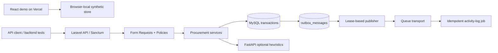

# Engineering case study — ProcurePilot AI

**Source-backed technical walkthrough · initial review November 19, 2026 · v21 operational update November 22, 2026 · portfolio implementation**

[Live synthetic demo](https://procurepilot-ai-nine.vercel.app/) · [Source repository](https://github.com/Will-ammari/procurepilot-ai) · [README](../README.md) · [API spec](openapi.yaml)

## 1. Context and constraints

ProcurePilot is a multi-tenant procurement system: a user prepares a request, procurement collects supplier quotations, a deterministic comparison precedes approvals, and finance records invoices. Every stage changes business state; decisions must be authorized, tenant-scoped, traceable, and safe under concurrent requests or delayed message delivery.

This case study describes **implemented code and the exact tests that exercise it**, not a claim that the backend is commercially deployed. The hosted Vercel React demo uses synthetic browser-local data. Laravel, MySQL, Redis and the optional FastAPI sidecar remain source/CI components.

**Engineering goals:**

1. Protect business invariants at the backend boundary, not in React.
2. Make state transition plus event persistence atomic.
3. Safely retry at-least-once asynchronous events.
4. Prevent inconsistent decisions when two users act concurrently.
5. Keep organization data isolated under both read and write APIs.

## 2. System boundaries



**Not connected:** the deployed frontend and the backend diagram's Laravel branch. `frontend/src/services/repository.ts` supports a separate API mode; the public instance is configured for demo mode.

## 3. Decision: serialize conflicting approval actions

### The problem

A manager can approve while another authorized actor attempts to reject the same approval step. If both read pending state before either writes, two conflicting decisions (and two audit events) are possible. Quote edits and comparison generation must not race a send-for-approval transition.

### The implementation

[`app/Services/Procurement/ApprovalWorkflowService.php`](../app/Services/Procurement/ApprovalWorkflowService.php):

1. Enter `DB::transaction()`.
2. Lock the **parent purchase-request row** first with `lockForUpdate()`.
3. Lock the specific approval step second, maintaining a stable lock order.
4. Re-load current state under lock and verify the step still belongs to the request.
5. Enforce pending state, request stage, preceding-step sequencing, and authorization.
6. Persist one decision and its audit record within the transaction.

The parent-row-first convention is also used in quote/comparison and request modifications to reduce conflicting lock orders. Budget thresholds choose required roles: **under €1,000 manager; €1,000–€10,000 manager + finance; above €10,000 manager + finance + admin**. This rule is demonstrated in the implementation; it is not universal procurement policy.

```mermaid
sequenceDiagram
    participant A as Approval A
    participant B as Rejection B
    participant DB as MySQL
    A->>DB: Lock purchase request
    B->>DB: Wait for same lock
    A->>DB: Lock step; validate; approve; commit
    DB-->>B: Lock released
    B->>DB: Re-read state under lock
    B-->>B: Reject invalid second decision
```

**Evidence:** [`tests/Feature/Procurement/MySqlApprovalConcurrencyTest.php`](../tests/Feature/Procurement/MySqlApprovalConcurrencyTest.php) creates independent PHP processes/DB connections for a competing decision scenario. [`phpunit.mysql.xml`](../phpunit.mysql.xml) requires a dedicated disposable database and protective environment checks. [`mysql-approval-concurrency.yml`](../.github/workflows/mysql-approval-concurrency.yml) runs it against MySQL in CI.

**Trade-off:** per-request serialization lowers conflict risk but constrains throughput when many operations contend on the *same* purchase request. Lock timing and deadlock patterns still warrant measurement under real production load. SQLite in-memory tests alone do **not** establish MySQL lock behavior.

## 4. Decision: transactional outbox rather than enqueue-before/after-commit alone

### Failure scenario

Updating `purchase_requests.status = submitted` and sending a queue message are separate operations. If a process dies **after database commit but before a queue publish**, the business transition survives but its audit event may be lost. Queue dispatching before commit can conversely publish an event for a rolled-back transition.

### Implemented write path

[`PurchaseRequestService::submit()`](../app/Services/Procurement/PurchaseRequestService.php) performs the state transition under the purchase-request lock inside a DB transaction. The same transaction calls [`OutboxWriter::purchaseRequestSubmitted()`](../app/Services/Outbox/OutboxWriter.php). The writer rejects calls without an open transaction and creates the outbox record using a unique event key such as `purchase_request.submitted:123`.

```mermaid
sequenceDiagram
    participant User
    participant API as Laravel service
    participant DB as MySQL
    participant Pub as Outbox publisher
    participant Q as Queue worker
    User->>API: Submit draft request
    API->>DB: BEGIN + lock purchase_request
    API->>DB: Set status=submitted
    API->>DB: INSERT unique outbox event key
    API->>DB: COMMIT both records
    Pub->>DB: Claim due event under lock; lease token
    Pub->>Q: Dispatch allow-listed job
    Pub->>DB: Mark dispatched, or retry / terminal-fail
    Q->>DB: Upsert submitted audit with idempotency key
```

[`OutboxPublisher.php`](../app/Services/Outbox/OutboxPublisher.php) claims due events under a transaction and `lockForUpdate`, moves them to `processing` with a lease token and expiry, then dispatches outside the claim transaction. It records success, or schedules exponential-backoff retries. Default batch is 50 (bounded at 100), the lease is 90 seconds, and a terminal failure is recorded after 12 attempts; [`ops:outbox:retry`](../app/Console/Commands/RetryOutbox.php) allows explicit operator recovery. There are maintenance/retention commands; undelivered events are not pruned by the documented retention flow.

[`QueueOutboxTransport.php`](../app/Services/Outbox/QueueOutboxTransport.php) allow-lists the supported event type and checks typed payload fields rather than dispatching arbitrary job names. [`RecordPurchaseRequestSubmitted.php`](../app/Jobs/Procurement/RecordPurchaseRequestSubmitted.php) uses an idempotency key when writing the activity log, protecting against duplicate processing of the same submission.

### Guarantee, explicitly scoped

**At-least-once delivery attempt, not exactly-once processing.** A crash after the transport dispatch but before the publisher marks its row dispatched can cause repeated dispatch. The consumer's unique audit key is what makes that *particular downstream audit write* idempotent. There is no claim that every conceivable external side effect is exactly once.

**Evidence:** [`tests/Feature/Operations/OutboxReliabilityTest.php`](../tests/Feature/Operations/OutboxReliabilityTest.php) covers commit/rollback atomicity, failed transport, expired lease, terminal failure/manual retry, pruning safety, invalid event payloads and duplicate consumer delivery. [`MySqlOutboxConcurrencyTest.php`](../tests/Feature/Operations/MySqlOutboxConcurrencyTest.php) checks competing publisher claims with real MySQL connections.

**Trade-off:** the outbox adds storage, a polling publisher, retention policy, a reconciliation surface, and the need for job-level idempotency. It improves event durability but does not eliminate outages or replace alerting/operations.

## 5. Decision: tenant isolation and least privilege in Laravel

The trust boundary is the **Laravel API**. React demo role switching is deliberately not treated as security control.

- [`PurchaseRequestService::paginatedForUser()`](../app/Services/Procurement/PurchaseRequestService.php) scopes queries to the authenticated user's `organization_id`, then narrows requester/manager visibility.
- [`PurchaseRequestPolicy.php`](../app/Policies/PurchaseRequestPolicy.php) explicitly rejects cross-organization access and checks role/action permissions.
- [`StorePurchaseRequestRequest.php`](../app/Http/Requests/Api/V1/StorePurchaseRequestRequest.php) and other Form Requests constrain server-side validation and relationships; the server derives organization and requester IDs on create, not from arbitrary client payloads.
- [`routes/api.php`](../routes/api.php) protects business APIs under `auth:sanctum` (with a separate throttled login route).

**Evidence:** [`TenantIsolationTest.php`](../tests/Feature/Procurement/TenantIsolationTest.php) covers cross-tenant detail reads, tenant-safe lists and cross-tenant department injection; [`AuthorizationPolicyTest.php`](../tests/Feature/Procurement/AuthorizationPolicyTest.php) covers role-focused restrictions; [`ApprovalStepsReadApiTest.php`](../tests/Feature/Api/V1/ApprovalStepsReadApiTest.php) exercises approval-step read scoping.

**Remaining risk:** authorization correctness needs continuous review for every new route, background task and object relation. A passing feature suite is not proof of a completed external security assessment.

## 6. Decision: deterministic analysis, never implicit AI authority

[`QuoteAnalysisService.php`](../app/Services/AI/QuoteAnalysisService.php) can invoke an optional FastAPI sidecar outside a DB transaction, validate the returned shape, lock and reload the quote, and reject stale snapshots before persisting analysis. Fallback behavior is deterministic. [`docs/reliability-and-performance.md`](reliability-and-performance.md) documents the stale-analysis protection.

The FastAPI **mock provider uses heuristics**, not a trained production model. Comparisons are deterministic and approvals remain human decisions. The project does **not** claim measured model accuracy, calibrated confidence or autonomous purchasing.

**Evidence:** [`QuoteAnalysisReliabilityTest.php`](../tests/Feature/Procurement/QuoteAnalysisReliabilityTest.php) and [`QuoteAnalysisApiTest.php`](../tests/Feature/Api/V1/QuoteAnalysisApiTest.php).

## 7. Decision: make local operations observable without exposing business data

The [v21 operations implementation](V21_OBSERVABILITY_SECURITY_RUNBOOK.md) builds on request IDs and W3C trace context, bounded Redis-backed HTTP/event windows, outbox and failed-job snapshots, and structured logs. A scheduled exporter writes a Prometheus textfile into a Docker volume; an **internal-only** Nginx endpoint serves it to Prometheus, which supplies the provisioned Grafana dashboard. The metric dimensions are allow-listed and do not include tenant IDs, users, supplier names or arbitrary request paths.

This topology is intentionally **local-first**. Prometheus collects the measurements and evaluates five rules for exporter freshness, outbox backlog, oldest undelivered event, terminal job failure and HTTP 5xx. Grafana displays panels and rule evaluation. No Alertmanager receiver is configured, so **delivering external notifications remains unimplemented**.

### Local evidence from November 22, 2026

| Check | Recorded result | What it does not prove |
| --- | --- | --- |
| Laravel PHP tests | **146 passed, 2 skipped, 559 assertions** | The default local suite skipped two opt-in MySQL concurrency cases; the separate MySQL CI workflow targets those scenarios |
| Static analysis and code style | PHPStan **0 errors**; Laravel Pint **192 files passing** | Absence of runtime defects or complete security coverage |
| Authentication boundary | An unauthenticated `/api/v1/purchase-requests` request returned **JSON 401** with `X-Request-Id` and no debug trace | All routes, tokens and authorization scenarios are secure by default |
| Metrics pipeline | Generated 401 requests changed the Grafana HTTP 4xx rolling-window gauge; `up{job="procurepilot"}=1` | Exact all-time request counts, p99 latency or production traffic |
| Failure/recovery drill | Stopped `metrics-http`; saw `up` transition **1 -> 0 -> 1**, plus `ProcurePilotMetricsUnavailable` **Pending -> Firing** in Grafana | Notification delivery, automatic remediation, production SLOs or incident history |
| Local runtime preflight | `APP_DEBUG` disabled and a stable `APP_KEY` detected; loopback-only published Docker ports | Production TLS, backups, IAM, secret rotation or external penetration testing |
| GitHub Actions | Laravel CI and isolated MySQL concurrency/outbox workflow passed on commit [`84a864f`](https://github.com/Will-ammari/procurepilot-ai/commit/84a864f) | A deployed public backend or an exhaustive test matrix |

The metrics exporter freshness rule uses an absent/stale timestamp expression with `for: 2m`, not simply `up == 0`. Prometheus window gauges should not be interpreted with `rate()` as monotonic counters. The observed drill tests **detection and alert state transitions**, not any external pager or on-call response.

**Trade-off:** this adds a bounded monitoring workload and local config files, but keeps instrumentation low-cardinality and off the public API surface. It does not provide a distributed tracing backend, long-term retained metrics, externally reachable dashboards or a production incident management workflow.

## 8. Frontend and test strategy

The React frontend uses a repository boundary for demo vs API mode, route-level lazy loading, and session-scoped demo-role persistence. The public build runs on Vercel without a backend. Playwright tests run against isolated demo data and cover request submission, quotes/comparison/sequential approvals, finance, viewer permissions, 375/768/1440 CSS-pixel layouts, refresh/deep links and selected axe accessibility checks.

**Recorded frontend validation at v19.1 (user-provided PowerShell output, Nov 19, 2026):** 11/11 Vitest, 10/10 tooling, 30/30 Playwright (desktop + mobile), successful TS/ESLint/Prettier/build and `npm audit` reporting zero known advisories at that point. The MySQL/queue tests are independent from browser tests. See [`frontend/docs/QUALITY_HARDENING_V19.md`](../frontend/docs/QUALITY_HARDENING_V19.md).

The PageSpeed landing-page audit reported 100 Performance/Accessibility/Best Practices, 91 SEO on both viewport presets. This is **one set of lab results**, not proof of dashboard speed, real-user Core Web Vitals, or compliance. [Details →](performance-lighthouse.md).

## 9. Engineering trade-off matrix

| Decision | Benefit | Cost / limitation |
| --- | --- | --- |
| Ordered DB row locks | Deterministic state transitions under contention | Contended request serialization; deadlock monitoring still required |
| Outbox + leased publisher | Durable event intent, bounded retries | Extra table, polling, retention and operational visibility |
| Idempotent audit consumer | Safe duplicate replay for a known event | Every new external side effect needs its own idempotency design |
| Laravel policies + tenant-scoped queries | Defense in depth for authorization and list visibility | Must be applied consistently to every model/action |
| Deterministic quote evaluation/fallback | Reproducible results, safe degradation | Not a measured ML model; less contextual intelligence |
| Browser-local public demo | Free review without storing visitor data on a backend | Does not prove live API integration or production operations |
| Lazy routes and E2E quality gates | Smaller landing JS and regression evidence | Additional build/test complexity; field performance not measured |
| Local Prometheus and Grafana | Reproducible HTTP/outbox/queue metrics and alert-state evaluation | No external notification receiver, SLO proof or long-term hosted telemetry |

## 10. Reproduce the claims

```bash
# Laravel and static quality
composer install
composer lint
composer analyse
php artisan test

# Frontend
cd frontend
npm ci
npm run typecheck
npm run lint
npm run format:check
npm run test
npm run test:tooling
npm run build
npm run test:e2e
```

The MySQL concurrency suite must be run **only against an isolated disposable MySQL schema** using the guarded `phpunit.mysql.xml` instructions in [`reliability-and-performance.md`](reliability-and-performance.md). No production credentials are needed to inspect this portfolio.

## 11. What remains intentionally unproven

- Hosted public Laravel API connected to Vercel, real customer auth and payment flows.
- Comprehensive penetration testing, accessibility compliance audit or independent threat model.
- Production error budgets/SLOs, end-to-end distributed traces, production dashboards, backup-restore validation and real incident evidence. Local dashboards and a controlled metrics-endpoint recovery drill **have** been exercised.
- Real-user Web Vitals and reproducible before/after Lighthouse runs over equivalent conditions.
- Validated AI model quality beyond deterministic/mock logic.

**Conclusion:** the strongest evidence is not the demo screenshot; it is the cross-cutting agreement among domain services, concurrency/outbox tests, tenant-scope tests, CI configuration and operational runbooks. All claims above can be checked at the linked source paths.
