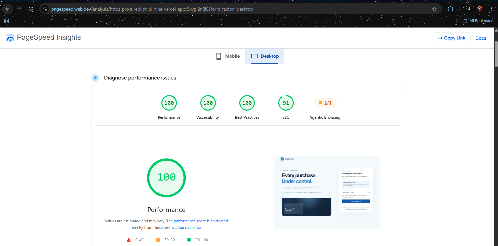

# PageSpeed Insights & frontend performance — evidence, limits, follow-up

**Captured by project owner: November 19, 2026** · Test URL: [`https://procurepilot-ai-nine.vercel.app/`](https://procurepilot-ai-nine.vercel.app/)

## Reported lab scores

The owner supplied screenshots from PageSpeed Insights showing the **public landing/login page** (not the authenticated dashboard) in both tested modes.

| Lighthouse category | Mobile | Desktop |
| --- | ---: | ---: |
| Performance | **100** | **100** |
| Accessibility | **100** | **100** |
| Best Practices | **100** | **100** |
| SEO | **91** | **91** |
| Agentic Browsing (experimental) | **2 / 4** | **2 / 4** |



*Screenshot evidence: submitted desktop PageSpeed Insights panel. The mobile score is taken from the supplied mobile screenshot in the chat; no separate mobile artifact was available for inclusion here.*

**Interpretation:** 100 is a **Lighthouse lab score for one tested page and environment**, not a proof of zero defects, zero load time or perfect Core Web Vitals for every route. Scores can vary by Lighthouse version, network, CPU and deployment. The images do not expose full LCP/INP/CLS timings, diagnostic opportunities or CrUX field samples, so those values are deliberately **not invented** here. Agentic Browsing is a separate, evolving audit and is not part of the ordinary Performance score.

## What was already done before these results

- Vite manifest with route-level lazy imports; Vite generates static and dynamic chunks.
- Regression script [`frontend/scripts/report-bundle.mjs`](../frontend/scripts/report-bundle.mjs) lists initial vs total JS and route chunks.
- v19.1 Playwright E2E tests (30/30), including refresh, keyboard/skip links, and axe critical/serious findings on targeted login, engineering and dashboard routes.
- ESLint, Prettier, TypeScript and clean production build checks in frontend CI.

The last uploaded v19.1 build log reported **initial JS = 400.39 kB raw / 128.61 kB gzip**, compared against a historical unsplit entry **583.09 kB raw / 181.43 kB gzip** (about **29.1% less initial gzip**). These are **build artifact estimates**, not LCP or real network-transfer measurements; post-change versions can differ. The same build reported **nine lazy route modules** and the total of all route JS at about 193.71 kB gzip.

## Findings and changes in this overlay

| Observed issue | Intervention | What can actually be asserted |
| --- | --- | --- |
| SEO 91 (cause not fully visible in supplied screenshots) | Explicit canonical landing URL, Open Graph/Twitter metadata and robots/sitemap for public landing + engineering case study | Improved metadata/discovery surface; **not** a guaranteed SEO score increase |
| Agentic `llms.txt` missing H1/links | A real static Markdown `frontend/public/llms.txt`, with a heading and relevant documentation URLs | Stops SPA fallback from being mistaken for `llms.txt` after redeploy; audit must be rerun |
| Agentic ARD response was HTML and invalid JSON | Real static `frontend/public/.well-known/ard.json` with `{ "entries": [] }` | The app publishes **no agentic tools**, so an empty manifest is honest and structurally permitted by ARD; no fake MCP service advertised |
| Potential fallback of machine-readable assets to index.html | Node regression tests check static payloads and links; Vite copies `public/` to `dist/` | Content is checked at build/test level; deployed HTTP response must still be checked |
| Core performance | **No speculative bundle redesign** while both measured Performance scores are 100 | Avoids changing a working UI solely to raise a score that is already excellent |

`/.well-known/ard.json` is a metadata/discovery document only: it does **not** grant an AI agent any access to the user workspace or authorize machine actions. The public demo exposes no MCP/WebMCP or autonomous purchasing endpoints. A valid empty ARD manifest may change the experimental score; this does not establish agent readiness.

## Reproduce measurements after deployment

1. Run the frontend quality suite (from `frontend/`):

   ```bash
   npm ci
   npm run typecheck
   npm run lint
   npm run format:check
   npm run test
   npm run test:tooling
   npm run build
   npm run test:e2e
   ```

2. Deploy and validate HTTP responses (browser address bar or PowerShell):

   ```powershell
   (Invoke-WebRequest 'https://procurepilot-ai-nine.vercel.app/llms.txt').Content
   (Invoke-WebRequest 'https://procurepilot-ai-nine.vercel.app/.well-known/ard.json').Content
   (Invoke-WebRequest 'https://procurepilot-ai-nine.vercel.app/robots.txt').Content
   (Invoke-WebRequest 'https://procurepilot-ai-nine.vercel.app/sitemap.xml').Content
   ```

   Expect **Markdown** for `llms.txt` (starting with `# ProcurePilot AI`) and **JSON** for the ARD file with an `entries` array; receiving `<!doctype html>` means the SPA fallback was served instead of the expected static asset. Verify HTTP status and `Content-Type` in DevTools if needed.

3. Open [PageSpeed Insights](https://pagespeed.web.dev/), analyse `https://procurepilot-ai-nine.vercel.app/`, and record **mobile and desktop separately**, preferably 3 runs per mode. Store results/date/URL and report **median**, not only the best number.
4. Repeat on `/engineering`. It is a client-rendered SPA route, so indexability and metadata may still depend on JavaScript execution; SSR/prerendering would require a deliberate project change.
5. For authenticated routes, use Chrome DevTools Lighthouse in a logged-in browser session or a scripted synthetic test, and distinguish lab measurements from Real User Monitoring.

## Follow-up template

| Date (UTC) | Git commit | URL/route | Mode | Performance | Accessibility | Best Practices | SEO | LCP | CLS | Notes |
| --- | --- | --- | --- | ---: | ---: | ---: | ---: | --- | --- | --- |
| 2026-11-19 (owner screenshots) | `06b13f2` (reported deployed base) | `/` | Desktop | 100 | 100 | 100 | 91 | not supplied | not supplied | Agentic 2/4 |
| 2026-11-19 (owner screenshots) | `06b13f2` (reported deployed base) | `/` | Mobile | 100 | 100 | 100 | 91 | not supplied | not supplied | Agentic 2/4 |
| After next deployment | record | `/` | Desktop/Mobile | pending | pending | pending | pending | pending | pending | Rerun needed |

## Reading / specs

- [Google PageSpeed Insights](https://pagespeed.web.dev/)
- [Vite `public/` assets](https://vite.dev/guide/assets.html#the-public-directory) — copied to `dist/` unchanged.
- [Vercel Vite SPA rewrites](https://vercel.com/docs/frameworks/frontend/vite) — still needed for deep links.
- [Agentic Resource Discovery spec v0.91](https://agenticresourcediscovery.org/spec/) — an ARD manifest is an `entries` array of resources; no fabricated services in this demo.
- [llms.txt format](https://llmstxt.org/) — Markdown with a clear H1 and links.
