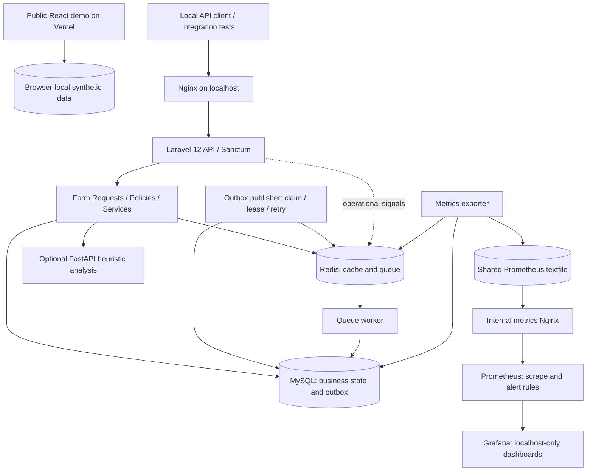
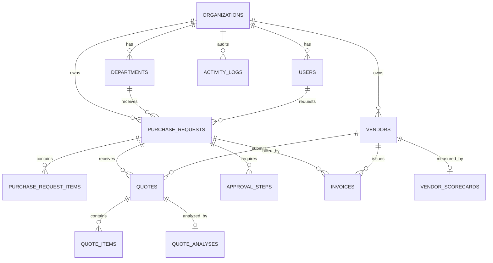

# ProcurePilot AI Architecture

ProcurePilot AI is a **local-first, production-style Laravel 12 procurement backend** built around tenant-scoped operations, policy authorization, concurrency-safe approvals, transactional outbox delivery and operational telemetry. The Vercel React demo is synthetic and **is not connected** to a deployed Laravel API.

## System context and deployment boundary



The public demo does not use the API branch. Docker Compose supplies local services and loopback-only published development ports. Prometheus and the metrics HTTP endpoint are isolated on an internal Docker network; Grafana has a separate bridge for host access. Prometheus rules can enter Pending/Firing, but **no Alertmanager/notification receiver is configured**. See the [v21 runbook](V21_OBSERVABILITY_SECURITY_RUNBOOK.md).

## Request submission: state transition and event persistence

```mermaid
sequenceDiagram
    actor User
    participant API as Laravel API
    participant Policy as Policy / service checks
    participant DB as MySQL
    participant Publisher as Outbox publisher
    participant Redis as Redis queue
    participant Worker as Idempotent consumer

    User->>API: POST purchase request submit (Sanctum)
    API->>Policy: Authorize tenant + state transition
    Policy-->>API: Allowed
    API->>DB: BEGIN; lock purchase request
    API->>DB: Update business status
    API->>DB: INSERT unique outbox event (same transaction)
    API->>DB: COMMIT state and event atomically
    API-->>User: Resource response
    loop Poll / retry due events
        Publisher->>DB: Claim due row with lock and lease
        DB-->>Publisher: Typed event payload
        Publisher->>Redis: Enqueue allow-listed job
        Publisher->>DB: Mark dispatched or schedule retry
    end
    Redis->>Worker: Deliver job (at least once)
    Worker->>DB: Idempotent activity-log write
```

**Why not just `dispatch afterCommit`?** A process can exit after committing business state but before publishing a queue message. Writing the outbox event in the **same database transaction** retains the publication intent. The publisher may dispatch again after a crash, so the consumer's idempotency key protects the known audit side effect. This is **at-least-once delivery**, not a general exactly-once guarantee. See the [case study](engineering-case-study.md) and [outbox reliability tests](../tests/Feature/Operations/OutboxReliabilityTest.php).

## Approval concurrency boundary

For conflicting approve/reject actions, services acquire the **parent purchase-request lock before the approval-step lock**, reload and validate current state, then persist at most one valid decision. The isolated MySQL workflow tests this behavior with independent processes; SQLite-only tests do not prove real MySQL lock semantics. See [`ApprovalWorkflowService.php`](../app/Services/Procurement/ApprovalWorkflowService.php) and [`MySqlApprovalConcurrencyTest.php`](../tests/Feature/Procurement/MySqlApprovalConcurrencyTest.php).

## Domain model



## Design decisions and boundaries

- Controllers delegate validation/authorization to Form Requests and Policies; procurement Services enforce state transitions, tenant ownership and invoice rules.
- Lock ordering and state revalidation guard against concurrent conflicting approvals.
- The `outbox_messages` table durably records publication intent; a leased publisher retries failures and an idempotent consumer prevents repeated audit writes for the same event.
- Optional FastAPI analysis is validated and has deterministic fallbacks; neither the public demo nor the backend is claimed to host a production LLM.
- API error responses use a consistent JSON contract (including unauthenticated `401`), security headers, request IDs and propagated trace context; this is correlation, **not full distributed tracing**.
- Bounded Redis-backed rolling-window metrics and DB snapshots are exported as Prometheus textfiles; dashboards and alert rule evaluation were exercised **locally**, with no production SLO or external pager guarantee.

## Verification and limitations

- [Laravel CI](https://github.com/Will-ammari/procurepilot-ai/actions/workflows/ci.yml) covers code quality and tests; [MySQL concurrency workflow](https://github.com/Will-ammari/procurepilot-ai/actions/workflows/mysql-approval-concurrency.yml) uses a disposable database.
- Local v21 evidence (November 22, 2026): 146 PHPUnit tests passed, 2 opt-in MySQL tests skipped in the default suite, 559 assertions; Pint 192 files; PHPStan 0 errors. In a controlled drill Prometheus recorded target failure/recovery and the metrics-unavailable rule entered Pending/Firing.
- The public React demo is separate from backend runtime; no live backend uptime, real customer usage, production TLS/IAM/backups, independent penetration test or delivered alert notifications are claimed.
- [Security threat model](V21_SECURITY_THREAT_MODEL.md) and [v21 operational runbook](V21_OBSERVABILITY_SECURITY_RUNBOOK.md) enumerate remaining controls and repeatable checks.
